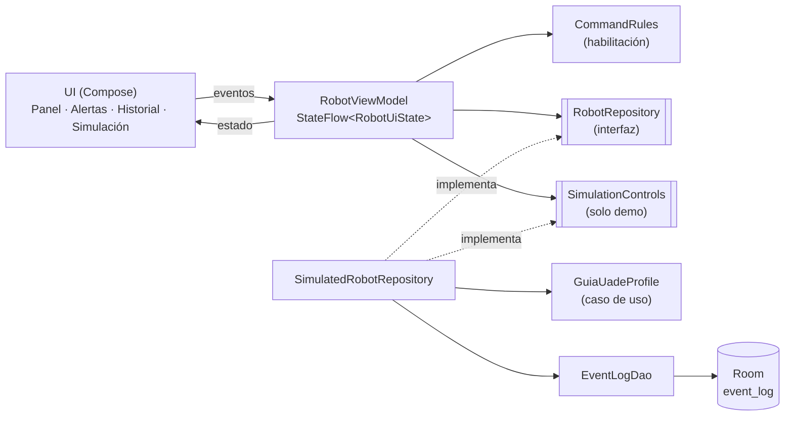
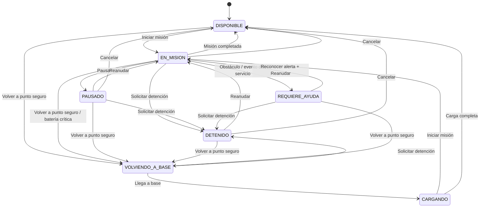
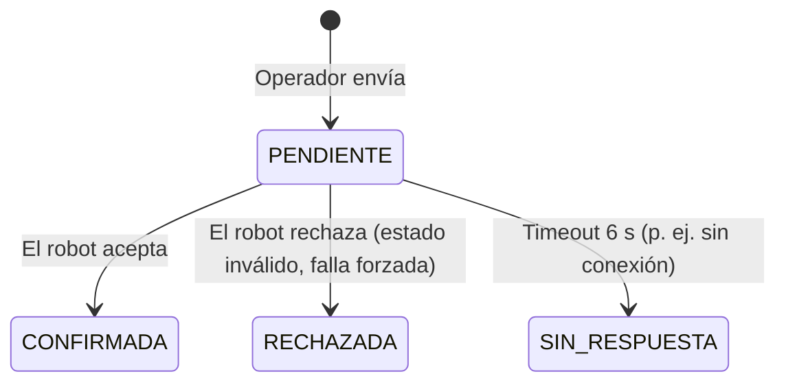

# Arquitectura

## Capas

- La **UI** solo observa `RobotUiState` y llama funciones del ViewModel. No conoce al simulador.
- El **ViewModel** combina telemetría, órdenes, alertas y un reloj (para detectar datos viejos) y calcula qué comandos están habilitados con `CommandRules`.
- El **Repository** es una interfaz. Hoy la implementa el simulador; un robot real tendría otra implementación con la misma interfaz.
- El **simulador** valida de nuevo cada orden (el robot es la fuente de verdad: la app puede tener datos viejos).

## Estados del robot

## Ciclo de vida de una orden

"Confirmada" significa que el robot **aceptó** la orden, no que la tarea ya se completó.
"Sin respuesta" **no** significa que no se ejecutó: el operador tiene que verificar el estado.
