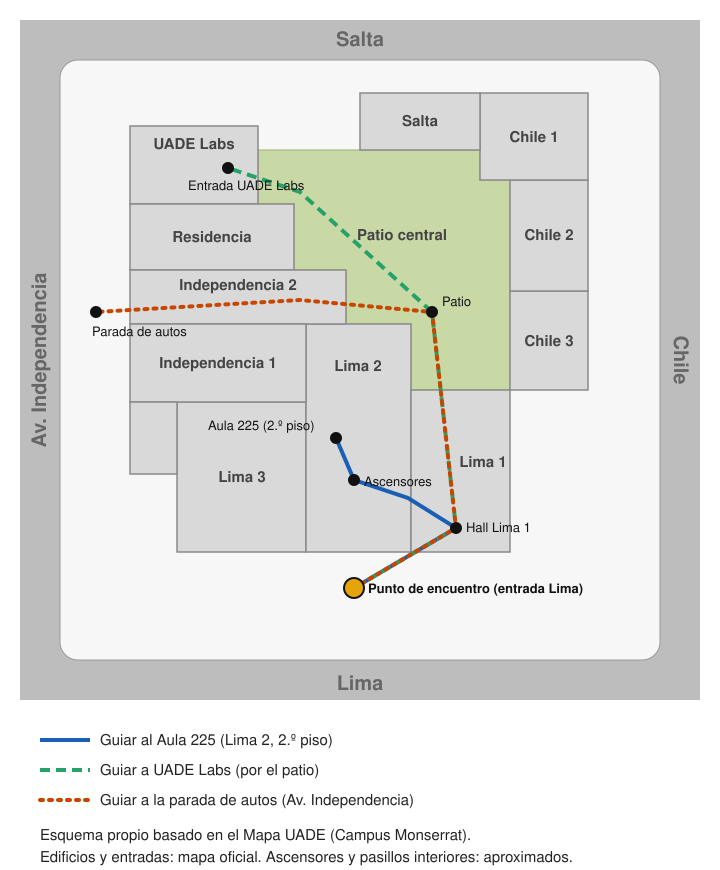

# Caso de uso: guía para personas con baja visión en UADE

> Borrador para la preentrega (punto 1 y 2 de la consigna). Completar con el plano real de la sede y las fuentes técnicas que investiguemos.

## Problema

Una persona ciega o con baja visión que llega a una sede UADE (alumno nuevo, ingresante, visitante en una jornada) tiene que llegar a un aula, a Bedelía o a la Biblioteca en un edificio de varios pisos que no conoce, con pasillos que se llenan en los cambios de turno.

**Cómo se resuelve hoy:** pidiendo ayuda a otra persona (personal, bedeles, compañeros), memorizando el recorrido con práctica previa, con bastón y señalética, o con una app en el celular. Cuando no hay nadie disponible (horas pico, turno noche), la persona depende de la buena voluntad de quien pase.

## Servicio propuesto

Un **Unitree Go2** con un **asa** guía a la persona desde el **Punto de encuentro** (entrada peatonal de Lima) hasta el destino, avisándole por voz giros, puertas y ascensores. Un **operador** supervisa los viajes desde la app y decide qué hacer ante incidentes.

## Actores

| Actor | Rol | Necesidad | Implicación en la interfaz |
| --- | --- | --- | --- |
| Persona guiada | Usuaria principal (HRI) | Llegar sin ayuda, saber dónde está y qué pasa | Voz clara, asa; nunca depender de una pantalla |
| Operador | Supervisa los viajes (HMI) | Saber si la persona está bien y cuándo intervenir | Estado del asa, alertas, comandos con confirmación |
| Alumnos y personal en el pasillo | Comparten el espacio (HRI) | Entender qué hace el robot y dejar paso | Pedido de paso por voz, movimiento predecible |
| Personal de apoyo | Acude cuando el operador lo pide | Saber dónde está la persona | Ubicación y aviso del operador |

## Entorno y recorrido: Campus UADE Monserrat

El campus ocupa la manzana entre **Lima, Chile, Salta y Av. Independencia**: edificios Lima 1, 2 y 3 sobre Lima; Chile 1, 2 y 3 sobre Chile; Salta; Independencia 1 y 2, Residencia y UADE Labs sobre Av. Independencia; y un **patio central**. Hay entrada peatonal por Lima, entradas peatonales y accesibles por Av. Independencia y una parada de autos sobre Av. Independencia (fuente: Mapa UADE, la app de la universidad).



Misión principal, siguiendo la ruta que marca el propio Mapa UADE (entrar por Lima, pasar por Lima 1 y girar a Lima 2):

```
Punto de encuentro (entrada Lima) → Hall de Lima 1 → Paso a Lima 2 → Ascensores de Lima 2 → 2.º piso → Aula 225
```

Otras misiones: **UADE Labs** (cruzando el patio central, al aire libre) y la **parada de autos** de Av. Independencia (para quien se va en taxi, remís o con un familiar).

Edificios y entradas salen del mapa oficial. **La ubicación de ascensores y pasillos interiores es aproximada**: hay que verificarla recorriendo la sede.

## ¿Por qué un robot y por qué Go2?

| Alternativa | Qué le falta |
| --- | --- |
| Acompañante humano | Es lo mejor en calidez, pero genera dependencia y no siempre hay alguien disponible. Ver la sección siguiente. |
| Señalética, piso podotáctil | Ayuda a orientarse, pero no guía físicamente ni avisa obstáculos que cambian (gente, sillas). |
| App de navegación en el celular | Indica, pero no tira del asa ni frena ante un obstáculo. Requiere manejar el teléfono mientras se camina. |
| Robot con ruedas | Más barato, pero no se adapta a desniveles y escalones. |
| **G1 (humanoide)** | Más pesado y alto, menos batería en uso continuo, y su forma no se asocia a guiar. |

El Go2 se elige por **forma y altura parecidas a las de un perro guía**, por moverse en desniveles y porque se lo puede equipar con un asa.

## ¿Por qué no alcanza con una persona que acompañe?

**El robot no reemplaza al acompañante: le saca la dependencia.** La persona llama a alguien cuando quiere hablar, no cuando necesita llegar.

1. **Autonomía.** Con un acompañante, la persona va cuando el otro puede y adonde el otro la lleva. En un museo de Tokio, visitantes ciegos guiados por un robot (CaBot) pasaron cerca del 30 % de la visita explorando sin ayuda humana, lo describieron como mucho más autónomo que sus visitas anteriores y prefirieron llamar al personal solo para preguntas puntuales, en lugar de ir acompañados todo el tiempo ([Kayukawa et al., CHI 2023](https://a11y-paradise.onrender.com/reviews/69e1a3de3624507234db7dbf)).
2. **Ritmo propio.** En ese mismo estudio, poder elegir el propio ritmo recibió 6–7 sobre 7.
3. **Disponibilidad en los picos.** El acompañante falta justo cuando más se lo necesita: cambio de turno, turno noche, días de examen de ingreso (UADE los toma presencialmente en el Campus Monserrat, Lima 757: [cronograma SIA](https://uade.edu.ar/media/wumc5ffi/sia-marzo-2026.pdf)). El robot está siempre.
4. **Escala (y es lo que justifica nuestra HMI).** Con acompañantes, cada persona ocupa a alguien del personal todo el viaje. Con robots, **un operador supervisa varios viajes a la vez** y solo interviene en los incidentes.
5. **Privacidad y dignidad.** No hay que explicarle la situación a un desconocido cada vez, ni ir acompañado a un trámite personal en Bedelía.
6. **Constancia.** El robot avisa siempre los mismos escalones, puertas y giros; la calidad del acompañamiento humano depende de quién toque.
7. **Los perros guía son muy escasos en Argentina.** Un proyecto en Diputados señala que la mayoría de los perros guía que se usan en el país se entrenaron en EE. UU. ([HCDN, 2015](https://www4.hcdn.gob.ar/dependencias/dcomisiones/periodo-133/133-1949.pdf)), y la escuela argentina había entregado poco más de 20 perros desde su fundación ([MDZ, 2021](https://www.mdzol.com/sociedad/2021/7/21/el-aporte-del-perro-guia-para-las-personas-con-discapacidad-visual-174054.html/amp)). Además, un perro guía no conoce el edificio: el robot sí tiene el mapa y lleva a un destino.
8. **Hay evidencia de aceptación.** Usuarios ciegos dijeron que CaBot superó ampliamente sus expectativas, lo compararon con un perro guía o un guía vidente y reportaron confianza y sensación de seguridad, sobre todo en lugares desconocidos ([CaBot, ASSETS 2019](https://research.ibm.com/publications/cabot-designing-and-evaluating-an-autonomous-navigation-robot-for-blind-people)).

**Lo que hay que reconocer en la defensa:** el acompañante humano es mejor en calidez y en situaciones imprevistas. Por eso el diseño deja siempre un humano a un paso: el operador puede mandar a alguien en cualquier momento, y el robot nunca deja sola a la persona.

## La sede

- Campus UADE Monserrat: Lima 775 (torre Lima 2) y Lima 757 ([fact sheet UADE](https://www.uade.edu.ar/media/ibnhqypk/fact-sheet-esp-2023.pdf)).
- El plano de la app sale del **Mapa UADE** (app de la universidad), que muestra la manzana, los edificios y cómo llegar a cada aula. El aula 225, por ejemplo, figura como "Lima 2, 2.º piso".
- El esquema `recorrido-campus.svg` es un dibujo propio con las mismas coordenadas que usa la app.

## Capacidades: lo que trae y lo que requiere

| Disponible en el Go2 (según versión) | Requiere equipamiento o desarrollo adicional |
| --- | --- |
| Caminar en interiores, desniveles y escaleras | **Asa con sensor** para saber si la persona la sujeta |
| Sensores de percepción (LiDAR) para obstáculos | **Voz bidireccional** clara en ambientes ruidosos |
| Wi-Fi / conectividad | **Ascensores**: el Go2 no aprieta botones → integración con el edificio o personal |
| SDK para desarrollo (versión EDU) | Mapa de la sede y navegación entre pisos |

Completar con las especificaciones de la versión elegida y sus fuentes.

## Telemetría

Obligatoria: conectividad, batería, estado operativo, misión y progreso, ubicación (piso y zona), movimiento, alertas y última actualización.

Variables del servicio:

1. **Asa**: sujetada / suelta / sin persona.
2. **Distancia al destino** (m).
3. **Gente en el pasillo**: poca / media / mucha (con mucha, el robot baja la velocidad y pide paso).

Extra de HRI: **último aviso por voz**, para que el operador sepa qué escuchó la persona.

## Comandos en el lenguaje del servicio

| Comando | Qué significa acá |
| --- | --- |
| Iniciar misión | "Guiar al Aula 225" |
| Pausar / Reanudar | La persona quiere frenar un momento / seguir |
| Cancelar | Se suspende el viaje; el robot queda con la persona y se avisa al personal |
| Volver a punto seguro | Volver **juntos** al Punto de encuentro |
| Solicitar detención | Detener el movimiento (software; no reemplaza una parada física) |
| Reconocer alerta | El operador confirma que leyó la alerta antes de decidir |

## Riesgos

| # | Riesgo | Medida |
| --- | --- | --- |
| 1 | Llevar a la persona hacia un peligro (escalera, puerta de vidrio) | Avisos por voz anticipados; recorridos solo por rutas habilitadas; prueba en entorno controlado |
| 2 | La persona se separa del robot | Sensor del asa: si la suelta, el robot se detiene, le habla y alerta al operador (escenario propio) |
| 3 | Dejar sola a la persona (batería, falla) | Con batería crítica el robot **no** se vuelve solo: se detiene junto a la persona y pide ayuda |
| 4 | Multitudes en el cambio de turno | Baja la velocidad, pide paso por voz; el operador puede pausar |
| 5 | Órdenes accidentales del operador | Confirmación para cancelar y volver; órdenes deshabilitadas con su motivo |
| 6 | Pérdida de conexión (ascensor, escaleras) | Datos marcados como viejos; órdenes que quedan "sin respuesta" sin suponer que se ejecutaron |
| 7 | Privacidad: la discapacidad es un dato sensible | No se guarda quién es la persona; el historial registra viajes, no identidades; no se graba video |
